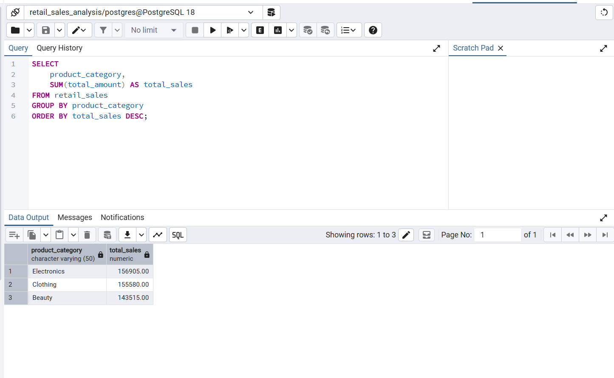

# Retail Sales Analysis (SQL)

## Project ke baare mein
Ek retail store ke sales data ka SQL analysis. Isme data cleaning, EDA aur business questions ke jawab nikale gaye hain.

## Tools
- PostgreSQL 18
- pgAdmin 4

## Dataset
Kaggle Retail Sales Dataset: 1000 rows, 9 columns (Transaction ID, Date, Customer ID, Gender, Age, Product Category, Quantity, Price per Unit, Total Amount). Data 1 Jan 2023 se 1 Jan 2024 tak ka hai.

## Folder structure
- `data/` : CSV file
- `sql/` : saari SQL queries
- `screenshots/` : query results ki images
- `insights.txt` : insights ki lines

## Data cleaning
NULL values, total_amount ki calculation aur category/gender ki spelling check ki gayi. Data saaf mila.

## Business questions

### Q1: Kaunsi category ki sales sabse zyada hai?

```sql
SELECT product_category, SUM(total_amount) AS total_sales
FROM retail_sales
GROUP BY product_category
ORDER BY total_sales DESC;
```



**Insight:** Electronics (156,905) aur Clothing (155,580) lagbhag barabar hain, aur Beauty (143,515) sabse peeche hai.

### Q2: Har mahine ki sales kitni hai?
(Q1 jaisa hi pattern: heading, SQL, screenshot, insight)

### Q3: Gender wise sales
(Same pattern)

### Q4: Age group wise sales
(Same pattern)

### Q5: Overall summary
(Same pattern)

## Key findings
- Electronics aur Clothing sabse zyada sales dete hain.
- May 2023 sabse strong mahina raha.
- Male aur Female ki sales lagbhag barabar hai.